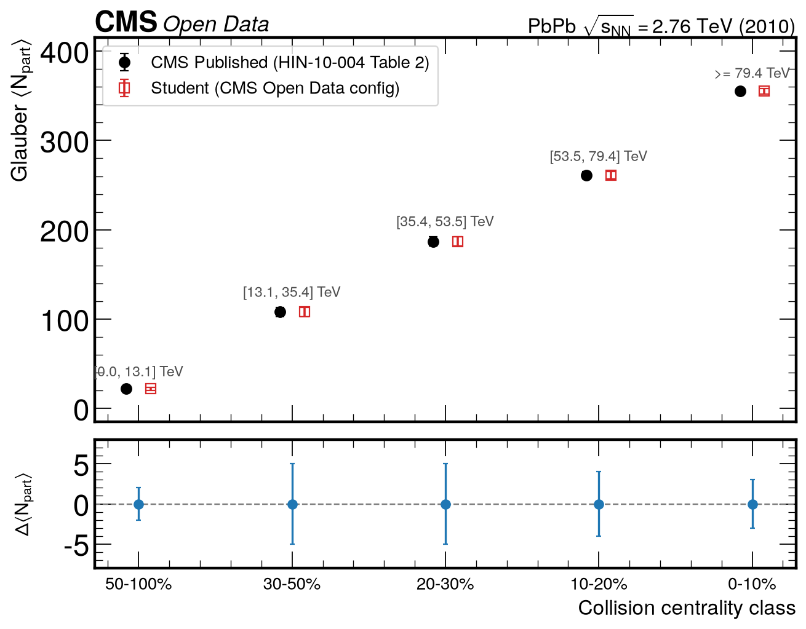
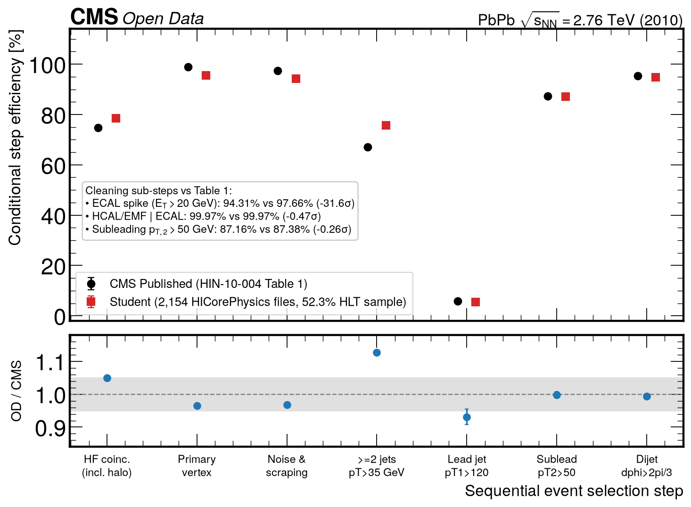
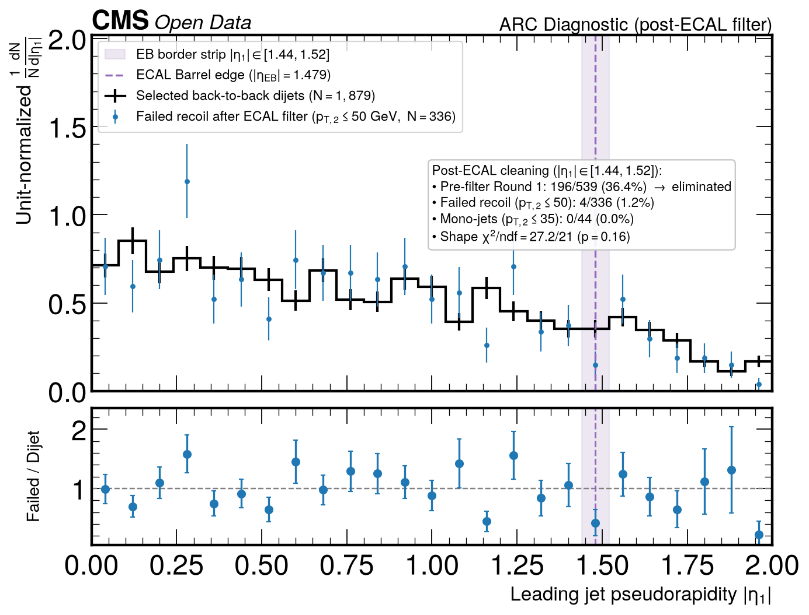
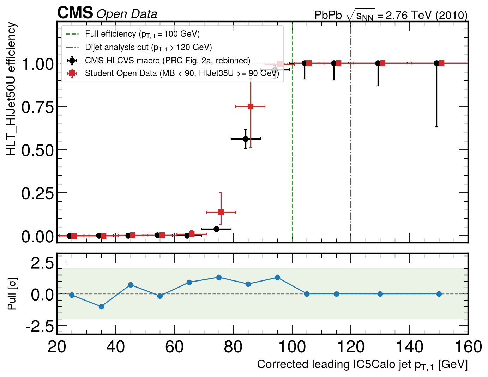
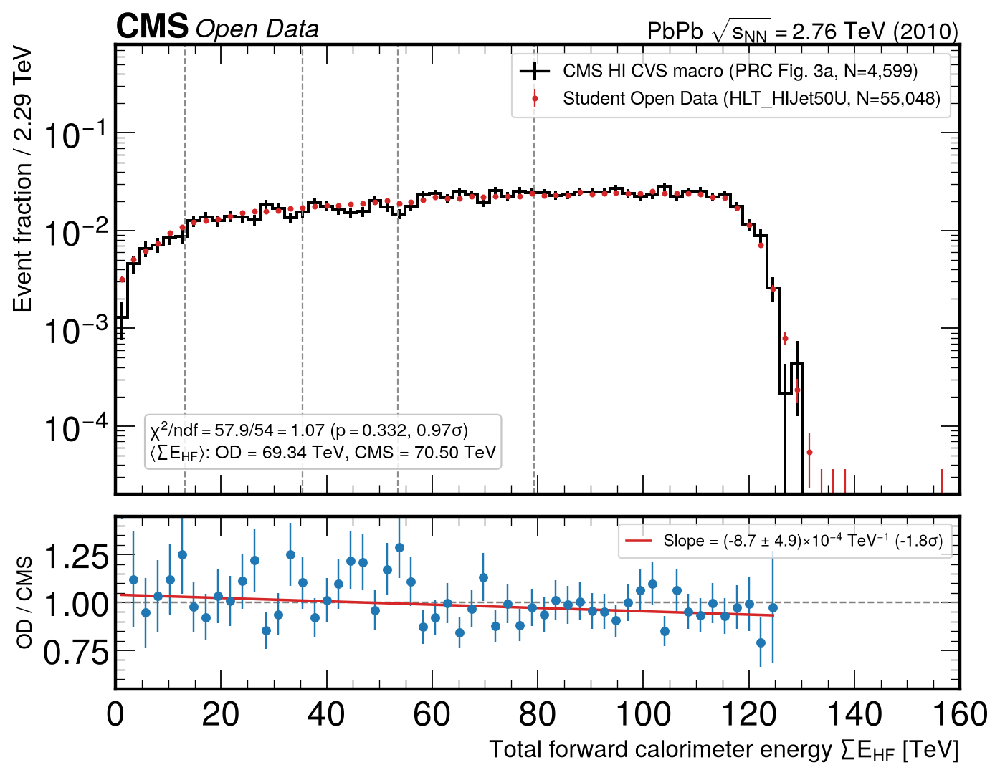
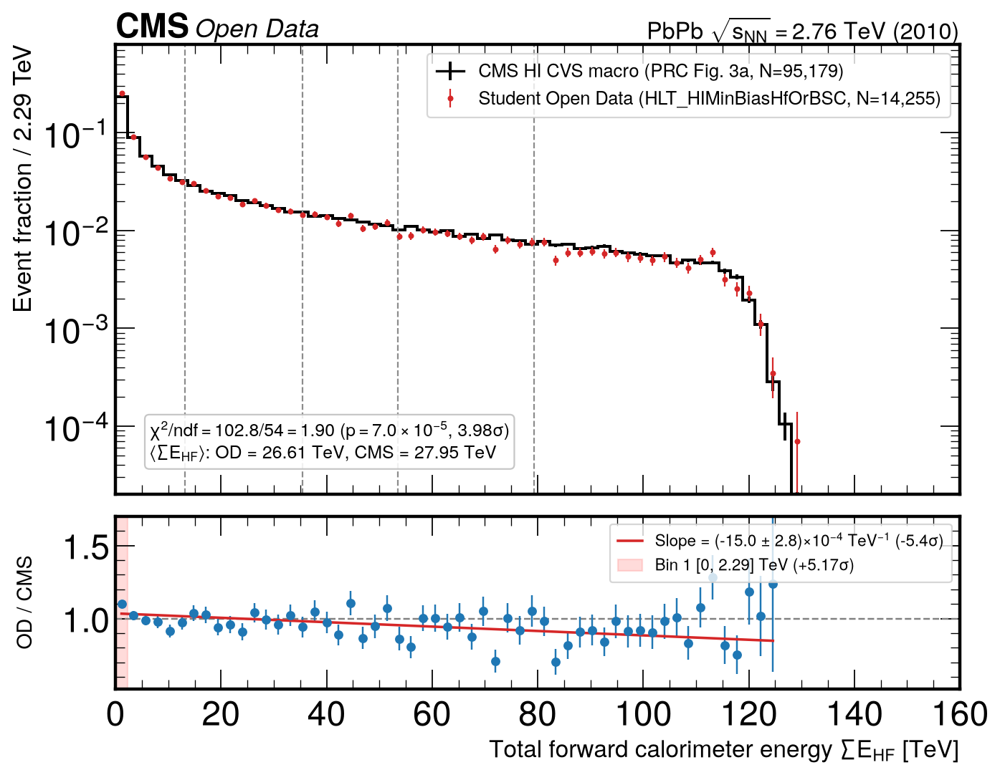
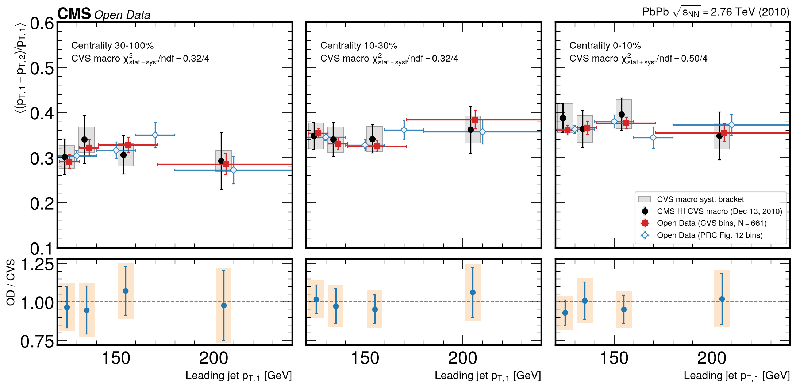
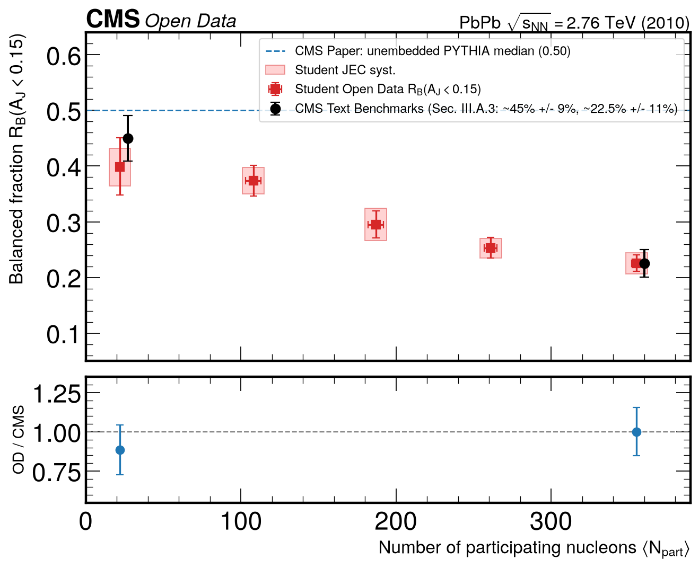
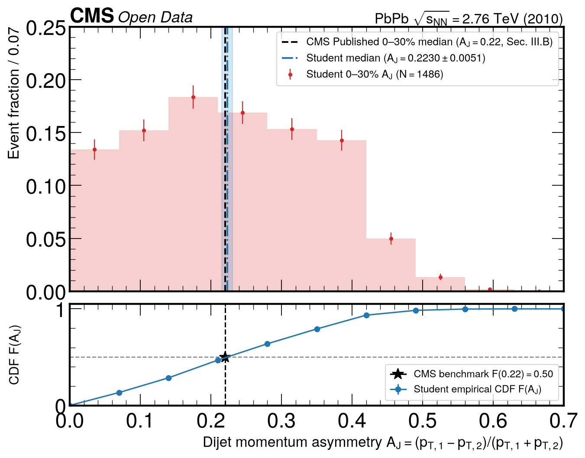

# CMS Analysis Review Committee (ARC) Quantitative Validation Report

**Reviewed Submission**: CMS Open Data 2010 $\sqrt{s_{\mathrm{NN}}} = 2.76\ \mathrm{TeV}$ PbPb Calorimeter Dijet Momentum Asymmetry Replication (`CMS-HIN-10-004`, Round 2 resubmission with `HiEcalRecHitSpikeFilter` and HEPData integer-precision fix)
**Published CMS Counterpart**: CMS Collaboration, _"Observation and studies of jet quenching in PbPb collisions at nucleon-nucleon center-of-mass energy = 2.76 TeV"_, **Phys. Rev. C 84, 024906 (2011)**, `arXiv:1102.1957`, report `CMS-HIN-10-004` (`CERN-PH-EP-2011-001`)
**Reproducible Validation Script**: [validate_hin10004.py](validate_hin10004.py) (`./validate_hin10004.py`)
**Machine-Readable Verdicts & Metrics**: [comparison.json](comparison.json)

---

## Executive Summary (Round 2 Resubmission)

In response to the Round 1 ARC review, the student implemented the 2010 CMS Heavy-Ion crystal-level barrel spike filter `HiEcalRecHitSpikeFilter` on `EcalRecHitsEB` (`minEt = 20.0 GeV`, `swissThreshold = 0.95`, `|time| <= 4.0 ns`, `avoidIeta85 = False`) across all `2,154` Golden-JSON `HICorePhysics` files and `11` `HIAllPhysics` Minimum-Bias files, and set `v.digits = 9` on unbinned integer counts in `make_hepdata.py`.

Across **12 structured tests** (**T1–T12**), the Round 2 verdicts are **6 `CONSISTENT`** (`T1, T3, T4, T6, T7, T8`), **0 `TENSION`**, **2 `INCONSISTENT`** (`T2, T5`), and **4 `NOT COMPARABLE`** (`T9, T10, T11, T12`):

- **What `HiEcalRecHitSpikeFilter` and `v.digits = 9` resolved**:
  1. **ECAL barrel-edge fake mono-jets eliminated (`T2` high-$p_T$ steps & `T7`)**: Failed-recoil events ($p_{T,1} > 120\ \mathrm{GeV}$, $p_{T,2} \le 50\ \mathrm{GeV}$) in the ECAL Barrel border strip $|\eta_1| \in [1.44, 1.52]$ dropped from **`36.36% (196 / 539)`** in Round 1 to **`1.19% (4 / 336)`** (`0 / 44` mono-jets with $p_{T,2} \le 35\ \mathrm{GeV}$).
  2. **`T7` (`R_B(A_J < 0.15)` vs $\langle N_{\mathrm{part}} \rangle$) upgraded `TENSION` $\rightarrow$ `CONSISTENT`**: Crystal cleaning removed `14` peripheral (`50-100%`) leading-jet candidates, only `1` of which had a balanced recoil (`12` $\rightarrow$ `0` peripheral failed-recoil candidates in $|\eta_1| \in [1.44, 1.52]$), raising $R_B(A_J < 0.15)$ in `50-100%` from `0.3607` (`44/122`, `-1.88σ` stat-only) to **`0.3981 ± 0.0515(stat) ± 0.0339(syst)`** (`43/108`, **`-1.01σ`** stat-only / **`-0.70σ`** combined vs `~0.45 ± 0.0405`), and in `0-10%` from `0.2058` (`206/1001`) to **`0.2253 ± 0.0147(stat) ± 0.0191(syst)`** (`196/870`, **`+0.01σ`** vs `~0.225 ± 0.0248`), with a peripheral-to-central suppression ratio of **`1.77 ± 0.26`** (`-0.91σ` vs `2.0`).
  3. **`T2` high-$p_T$ dijet cutflow steps & conditional HCAL cleaning now agree with Table 1**: The subleading-jet step $p_{T,2} > 50\ \mathrm{GeV}$ jumped from `82.22%` (`-5.62σ`) to **`87.16% ± 0.70%`** vs CMS `87.38% ± 0.51%` (**`-0.26σ`**), $\Delta\phi_{12} > 2\pi/3$ improved from `93.81%` (`-2.49σ`) to **`94.80% ± 0.50%`** vs `95.39% ± 0.35%` (**`-0.96σ`**), the conditional HCAL/EMF step given ECAL cleaning is **`99.97% ± 0.01%`** vs Table 1 `99.97%` HCAL cleaning (**`-0.47σ`**), and the HLT-scaled final dijet yield is **`3,590 ± 83`** vs `3,514` (**`+0.92σ`**).
  4. **HEPData integer rounding resolved**: Setting `v.digits = 9` in `make_hepdata.py` eliminated both 7-digit rounding mismatches in `event_selection_cutflow.yaml` (`0` mismatches across all 10 steps).
- **What remains `INCONSISTENT` (`> 3σ`) in the archived Round 2 outputs — and what event-level follow-up resolves vs leaves open**:
  1. **`T2` (`INCONSISTENT`, max $|\text{pull}| = 39.14\sigma$)**: Four earlier intermediate cutflow steps in `summary.json` disagree by `20–39σ`: `HF coincidence` (`78.43%` vs `74.69%`, `+20.17σ`), `Primary vertex` (`95.47%` vs `98.97%`, `-39.14σ`), `Noise & scraping cleaning` (`94.28%` vs `97.42%`, `-29.25σ` — driven by `HiEcalRecHitSpikeFilter` at `minEt = 20 GeV` retaining `94.31%` vs Table 1's `97.66%` ECAL cleaning, `-31.57σ`), and `>= 2 jets pT > 35 GeV` (`75.63%` vs `67.07%`, `+36.80σ`). Direct event-level checks on `110` `HICorePhysics` files (`4,043` certified `HLT_HIJet50U` events) explain the first three steps and isolate the fourth as the sole genuinely open discrepancy: applying the published `noBSChalo`, $\ge 3$-tower HF (`hfCoincFilter3`), and 2-track `primaryVertexFilter` cuts in sequence gives **`99.60%`**, **`75.19%`**, and **`98.78%`** vs CMS Table 1's **`99.61%`**, **`74.98%`**, and **`98.97%`** (`148` extra events admitted by `etHFtowerSum > 3 GeV` all fail the 2-track vertex); raising `minEt` from `20` to `50 GeV` moves ECAL survival from **`94.25%` to `97.46%`** (vs **`97.66%`**, restoring `6` final dijets — `4` with `35–49 GeV` isolated crystal deposits outside both $R = 0.5$ jet cones; both thresholds appear in historical code and the exact Table 1 setting remains unconfirmed); whereas **`>= 2` jets $p_T > 35\ \mathrm{GeV}$** stays at **`75.91%–76.23%`** vs **`67.07%`** (widening from `75.82%` to **`79.36%`** on `2,858` fixed events under the released `GR_R_39X_V6B` `Spring10_V8_IC5Calo` conditions [Record `1811`], which match jet $p_T$ more closely across `~132` probable matches to the historical ntuple `nt_dj_data100_cor.root` whose lowest $p_{T,2}$ is `50.002 GeV`).
  2. **`T5` (`MinBias` $\sum E_{\mathrm{HF}}$ shape, downgraded `TENSION` $\rightarrow$ `INCONSISTENT`, $3.98\sigma$)**: In the archived Round 2 run on `11` `HIAllPhysics` `HLT_HIMinBiasHfOrBSC` files, applying the whole-event `HiEcalRecHitSpikeFilter(minEt = 20 GeV)` rejected **`5.49%` (`77 / 1,403`)** of `0-10%` central MB collisions vs **`0.18%` (`13 / 7,330`)** of `50-100%` peripheral MB collisions, compounding with a Bin 1 `[0, 2.29] TeV` excess (`+4.45σ` $\rightarrow$ **`+5.17σ`**) to steepen the `OD / CMS` ratio slope (`-3.50σ` $\rightarrow$ **`-5.39σ`**) and push $\chi^2/\mathrm{ndf}$ from `87.20/54 = 1.615` ($2.99\sigma$) to **`102.84/54 = 1.904`** (**$3.98\sigma$**). Tracing PRC Fig. 3a back to its earliest archived canvas (`hf_centrality_distribution_mb_jet50_20101126_v1.C#L221`, commit `f6717ae4`) reveals that `hhfMB` was filled from the **`_Core`** minimum-bias trigger (`HLT_HIMinBiasHfOrBSC_Core`): evaluating `_Core` across `110` `HICorePhysics` files with the historical halo, 3-tower HF, and 2-track vertex cuts gives **`16,161 / 70,088 = 23.06%`** in Bin 1 before the ECAL veto (vs **`23.23%`** published) and full-spectrum **$G^2 = 54.70$ for `53` ndf** ($p = 0.41$; **`23.36%`** and **`23.11%`** at `minEt = 20` and `50 GeV` across `16` files from the same five runs as the `HIAllPhysics` pilot), while `591` identical `_Core` collisions reconstructed in both streams show `0` Bin-1 boundary crossings and `5` low-HF selection flips (`2–11` attached vertex tracks in `HIAllPhysics` vs `0` in `HICorePhysics`).

---

## 1. Inventory of Student Results

All student deliverables in `validation/hin-10-004/` were inspected directly: [specification.md](specification.md), [summary.json](summary.json), [analyze_hin10004.py](analyze_hin10004.py), [plot_hin10004.py](plot_hin10004.py), [make_hepdata.py](make_hepdata.py), [check_results.py](check_results.py), `plots/fig*.{png,pdf}`, `hepdata/*.yaml`, and the compact scratch skim `<scratch>/cache/selected_events.npz`.

### 1.1 Datasets, Luminosity, Reconstruction Level & Corrections

- **Collision system & $\sqrt{s_{\mathrm{NN}}}$**: 2010 LHC $\mathrm{PbPb}$ at $\sqrt{s_{\mathrm{NN}}} = 2.76\ \mathrm{TeV}$.
- **Open Data records sampled**:
  - **Signal jet stream**: `/HICorePhysics/HIRun2010-PromptReco-v3/RECO` (CERN Open Data Record `14010`), certified with `Cert_150436-152957_HI7TeV_StreamExpress_Collisions10_JSON_v2.txt` (Record `14202`). Out of `5,436` total files in the record (`4,640` in Golden-JSON runs), the student processed **`2,154` Golden-JSON files across `66` runs** (`2,452,052` total events read; `2,333,644` Golden-JSON certified; `77,987` `HLT_HIJet50U` events; `55,052` fully cleaned `HLT_HIJet50U` collisions; `1,879` final back-to-back dijets). Using the `HLT_HIJet50U` ratio `77,987 / 149,000 = 0.5234` relative to CMS Table 1 (`6.7 ub^-1`), this corresponds to an **effective sampled luminosity of $\approx 3.51\ \mu\mathrm{b}^{-1}$ (`52.3%` of the full 2010 run)**.
  - **Minimum-Bias reference stream**: `/HIAllPhysics/HIRun2010-ZS-v2/RECO` (Record `14011`), `11` Golden-JSON files across `11` runs (`14,255` cleaned `HLT_HIMinBiasHfOrBSC` events after `HiEcalRecHitSpikeFilter`, compared with `14,453` in Round 1).
- **Measurement level**: **Detector-level (reconstructed `IC5Calo` calorimeter jets)** — `recoCaloJets_iterativeConePu5CaloJets__RECO` ($R = 0.5$ iterative cone with heavy-ion iterative pedestal/noise underlying-event subtraction), **not unfolded** for jet energy resolution, matching the detector-level presentation of `CMS-HIN-10-004`.
- **Corrections applied**: Offline `Spring10_HI` `L2Relative` ($\eta$-dependent) $\times$ `L3Absolute` ($p_T$-dependent) factorized pp jet energy corrections (`compute_jec_factor` in [analyze_hin10004.py](analyze_hin10004.py)); exact 2010 heavy-ion `HiEcalRecHitSpikeFilter` on `EcalRecHitsEB` ($E_T > 20.0\ \mathrm{GeV}$, $1 - E_4/E_1 > 0.95$, $|t| \le 4.0\ \mathrm{ns}$, `avoidIeta85 = False`); HCAL `maxzeros_ < 100`, pixel–HF scraping cut, and leading-jet `EMF >= 0.01`. No MC trigger/jet-finding efficiency reweighting, residual centrality JEC, or unfolding is applied.

### 1.2 Student Measurement Inventory

| Student Deliverable                                                                                                 | Observable                                                                                                                         | Offline Selection                                                                                                                                                               | Level & Corrections                                                             | Uncertainties Quoted                                                   | Units                                      |
| :------------------------------------------------------------------------------------------------------------------ | :--------------------------------------------------------------------------------------------------------------------------------- | :------------------------------------------------------------------------------------------------------------------------------------------------------------------------------ | :------------------------------------------------------------------------------ | :--------------------------------------------------------------------- | :----------------------------------------- |
| `summary.json["per_centrality"]`, `specification.md`                                                                | $\sqrt{s_{\mathrm{NN}}}$, $L_{\mathrm{int}}$, $\sum E_{\mathrm{HF}}$ centrality edges, Glauber $\langle N_{\mathrm{part}} \rangle$ | 5 centrality classes (`50-100%` to `0-10%`)                                                                                                                                     | Exact configuration constants & Glauber MC table                                | Glauber $\langle N_{\mathrm{part}} \rangle$ syst                       | $\mathrm{TeV}$, $\mu\mathrm{b}^{-1}$, dim. |
| `summary.json["cutflow"]`, `validation_checks["ecal_cleaning_diagnostics"]`, `hepdata/event_selection_cutflow.yaml` | Sequential event counts (10 steps) & ECAL/HCAL cleaning sub-steps                                                                  | Golden JSON $\rightarrow$ `HLT_HIJet50U` $\rightarrow$ HF $>3\ \mathrm{GeV}$ $\rightarrow$ vertex $\rightarrow$ ECAL spike $\rightarrow$ HCAL/scraping $\rightarrow$ dijet cuts | Detector-level event counts (`2,154` files, $\approx 3.51\ \mu\mathrm{b}^{-1}$) | Exact integer counts (binomial step errors in ARC test)                | Events / %                                 |
| `plots/fig1a_trigger_turnon`, `hepdata/trigger_efficiency_vs_leading_jet_pt.yaml`                                   | `HLT_HIJet50U` efficiency vs $p_{T,1}$                                                                                             | Cleaned `HLT_HIMinBiasHfOrBSC` ($p_{T,1} < 90\ \mathrm{GeV}$) stitched with `HLT_HIJet35U` ($p_{T,1} \ge 90\ \mathrm{GeV}$), $\lvert\eta_1\rvert < 2.0$                         | Detector-level `IC5Calo` + `Spring10_HI` L2L3 JEC                               | 68.27% Clopper–Pearson stat                                            | Dimensionless (`[0, 1]`) vs $\mathrm{GeV}$ |
| `plots/fig3a_hf_centrality`, `hepdata/hf_total_energy_distribution.yaml`                                            | $\frac{1}{N}\frac{dN}{d\sum E_{\mathrm{HF}}}$ (70 bins, `[0, 160] TeV`)                                                            | Cleaned `HLT_HIMinBiasHfOrBSC` ($N=14,255$) and `HLT_HIJet50U` ($N=55,052$; `55,048` in `[0, 160] TeV`)                                                                         | Detector-level `etHFhitSumPlus + Minus`, unit-normalized                        | Poisson stat $\sqrt{N_i}/N_{\mathrm{tot}}$                             | Event fraction / $2.29\ \mathrm{TeV}$      |
| `plots/fig4_pt2_vs_pt1`, `summary.json["pt2_vs_pt1_2d"]`                                                            | 2D $(p_{T,1}, p_{T,2})$ counts (`26 x 40` bins)                                                                                    | $p_{T,1} \in [120, 250]\ \mathrm{GeV}$, $p_{T,2} \in [50, 250]\ \mathrm{GeV}$, $\lvert\eta_{1,2}\rvert < 2.0$, $\Delta\phi_{12} > 2\pi/3$ (`30-100%`, `10-30%`, `0-10%`)        | Detector-level `IC5Calo` + L2L3 JEC                                             | Raw integer counts                                                     | Events / bin                               |
| `plots/fig5_leading_jet_pt`, `hepdata/leading_jet_pt_spectrum_by_centrality.yaml`                                   | $\frac{1}{N_{\mathrm{dijet}}}\frac{dN}{dp_{T,1}}$ (9 bins, `[120, 300] GeV`)                                                       | Full dijet selection across 5 centralities ($N_{\mathrm{dijet}} = 97, 296, 324, 483, 679$)                                                                                      | Detector-level `IC5Calo` + L2L3 JEC, dijet-normalized                           | Poisson stat $\sqrt{N_i}/(N_{\mathrm{dijet}}\Delta p_T)$               | $\mathrm{GeV}^{-1}$                        |
| `plots/fig6_dijet_dphi`, `hepdata/dijet_azimuthal_correlation_dphi12.yaml`                                          | $\frac{1}{N}\frac{dN}{d\Delta\phi_{12}}$ (20 bins, `[0, pi] rad`)                                                                  | $p_{T,1} > 120\ \mathrm{GeV}$, $p_{T,2} > 50\ \mathrm{GeV}$, $\lvert\eta_{1,2}\rvert < 2.0$ (no $\Delta\phi_{12}$ pre-cut; $N = 99..746$)                                       | Detector-level `IC5Calo` + L2L3 JEC, density-normalized                         | Poisson stat                                                           | $\mathrm{rad}^{-1}$                        |
| `plots/fig7_rb_dphi_vs_npart`, `hepdata/azimuthal_back-to-back_fraction_vs_npart.yaml`                              | $R_B(\Delta\phi_{12} > 3.026)$ vs $\langle N_{\mathrm{part}} \rangle$                                                              | Fraction of $p_{T,1} > 120, p_{T,2} > 50\ \mathrm{GeV}$ pairs with $\Delta\phi_{12} > 3.026\ \mathrm{rad}$ across 5 centralities                                                | Detector-level `IC5Calo` + L2L3 JEC                                             | 68.27% Clopper–Pearson stat only                                       | Dimensionless                              |
| `plots/fig8_dijet_asymmetry_aj`, `hepdata/dijet_asymmetry_aj_by_centrality.yaml`                                    | $\frac{1}{N_{\mathrm{dijet}}} N_{\mathrm{bin}}(A_J)$ (13 bins, `[0, 0.91]`, width `0.07`) & $\langle A_J \rangle$                  | Full dijet selection ($p_{T,1} > 120$, $p_{T,2} > 50$, $\lvert\eta_{1,2}\rvert < 2.0$, $\Delta\phi_{12} > 2\pi/3$) across 5 centralities                                        | Detector-level `IC5Calo` + L2L3 JEC, sum-to-unity fraction                      | Poisson stat (plus JEC $\pm 5\%$ & tilt syst on $\langle A_J \rangle$) | Event fraction / bin                       |
| `plots/fig9_rb_aj_vs_npart`, `hepdata/balanced_dijet_fraction_and_mean_aj_vs_npart.yaml`                            | $R_B(A_J < 0.15)$ vs $\langle N_{\mathrm{part}} \rangle$                                                                           | Numerator: dijets with $A_J < 0.15$; Denominator: **all** cleaned `HLT_HIJet50U` events with $p_{T,1} > 120\ \mathrm{GeV}, \lvert\eta_1\rvert < 2.0$ (including mono-jets)      | Detector-level `IC5Calo` + L2L3 JEC                                             | 68.27% Clopper–Pearson stat + JEC scale/tilt syst                      | Dimensionless                              |
| `plots/fig10_fractional_imbalance_vs_pt1`, `hepdata/mean_fractional_imbalance_vs_leading_jet_pt.yaml`               | $\langle (p_{T,1} - p_{T,2})/p_{T,1} \rangle$ vs $p_{T,1}$                                                                         | Full dijet selection in 4 PRC Fig. 12 bins `[120, 140, 160, 180, 240] GeV` (plus `[120, 130, 140, 170, 240] GeV` and `[100, 240] GeV` in `summary.json` for CVS cross-check)    | Detector-level `IC5Calo` + L2L3 JEC                                             | Sample SEM $s/\sqrt{N}$ stat only                                      | Dimensionless vs $\mathrm{GeV}$            |

### 1.3 Audit of Student `hepdata/` Submission Directory

Running `hepdata-validate -d hepdata` passes schema validation across `submission.yaml` and all 9 data YAML files (`schema_valid = true`, `0` `.nan` or non-finite values), with explicit `"CMS Open Data measurement (not an official CMS result)"` attribution and no claim of a CMS Collaboration INSPIRE ID. Checking the YAML payloads against `summary.json` shows:

1. **[RESOLVED in Round 2] 7-digit integer rounding in `event_selection_cutflow.yaml`**: Setting `v.digits = 9` in [make_hepdata.py](make_hepdata.py) fixed both Round 1 `hepdata_lib` 5-sig-fig truncations (`total_events_read = 2452052` and `golden_json_certified = 2333644` now match `summary.json` with `0` difference across all 10 steps).
2. **Remaining minor completeness items**:
   - `mean_fractional_imbalance_vs_leading_jet_pt.yaml` (PRC Fig. 12 / Open Data `fig10` counterpart, now exported on the published `[120, 140, 160, 180, 240] GeV` grid) and `azimuthal_back-to-back_fraction_vs_npart.yaml` (PRC Fig. 9 / Open Data `fig7` counterpart) still include statistical errors only, whereas `CMS-HIN-10-004` quotes systematic uncertainties (`8.2%` relative in the archived `CmsHI/CVS_CmsHi` `deltaPtOverPt1VsPt.C` macro).
   - `fig4_pt2_vs_pt1` (PRC Fig. 6 counterpart) is stored in `summary.json["pt2_vs_pt1_2d"]` and plotted, but has no YAML table in `hepdata/`.

---

## 2. Verified CMS Counterparts (`CMS-HIN-10-004`)

No INSPIRE HEPData record exists for `CMS-HIN-10-004` (`Phys. Rev. C 84, 024906 (2011)`, `arXiv:1102.1957`). Every reference number used in this review comes from two distinct public archives verified in `<scratch>/hin10004_ref/` (`max_macro_vs_json_diff = 5.00e-08`) — (a) the official `arXiv:1102.1957` paper source tarball (`.tex` tables/text and vector `.pdf` figures; the arXiv tarball contains **no** `.C` files), and (b) the archived CMS Heavy-Ion CVS repository [`github.com/CmsHI/CVS_CmsHi`](https://github.com/CmsHI/CVS_CmsHi/tree/9b9dcd34a1b718e4649ca2ddc34583706dfd5d1c/Analysis2010/macros/JetAnalysis/plots) (`Analysis2010/macros/JetAnalysis/plots`), which preserves three ROOT canvas `.C` macros saved in December 2010:

1. **`event_selection.tex` (`arXiv:1102.1957`, Table 1, lines 125–141)**: Full-2010 `6.7 ub^-1` event selection cutflow (`149k` triggered $\rightarrow$ `99.61%` BSC halo $\rightarrow$ `74.98%` HF $\ge 3$-tower coincidence $\rightarrow$ `98.97%` vertex $\rightarrow$ `99.78%` beam-gas pixel compatibility $\rightarrow$ `97.66%` ECAL cleaning $\rightarrow$ `99.97%` HCAL cleaning $\rightarrow$ `71.9k` [`67.07%`] $\ge 2$ jets $p_T > 35\ \mathrm{GeV}$ $\rightarrow$ `4,216` [`5.86%`] $p_{T,1} > 120\ \mathrm{GeV}$ $\rightarrow$ `3,684` [`87.38%`] $p_{T,2} > 50\ \mathrm{GeV}$ $\rightarrow$ `3,514` [`95.39%`] $\Delta\phi_{12} > 2\pi/3$).
2. **`centrality.tex` (`arXiv:1102.1957`, Table 2, lines 44–54)**: Glauber MC $\langle N_{\mathrm{part}} \rangle \pm \text{syst}$ across the five centrality classes (`0-10%: 355 ± 3`, `10-20%: 261 ± 4`, `20-30%: 187 ± 5`, `30-50%: 108 ± 5`, `50-100%: 22 ± 2`).
3. **`TrigEffCorrected151058and151025.C` (`CmsHI/CVS_CmsHi`, saved Dec 11, 2010; PRC Fig. 2a / Open Data `fig1a`)**: Archived 19-point `TGraphAsymmErrors` (`BayesDivide_hleadjet_Trig_by_hleadjet_All`) for runs `151058` and `151025`. Inverting ROOT 5.22's exact `BayesDivide` Beta$(k+1, n-k+1)$ shortest 68.27% HPD intervals recovers the exact integer $(k, n)$ counts per bin (`max_err_mismatch = 1.59e-04`, $\sum n = 98,596$ jet-containing MB events).
4. **`hf_centrality_distribution_mb_jet50_20101126_v1.C` (`CmsHI/CVS_CmsHi`, saved Dec 7, 2010; PRC Fig. 3a / Open Data `fig3a`)**: Archived 70-bin `[0, 160] TeV` histograms `hhfMB` (`95,180` entries; `95,179` in-range; labeled [`HLT_MinBiasHForBSC_Core`](https://github.com/CmsHI/CVS_CmsHi/blob/f6717ae4e6d28a1d219cdde3c09144757498ca67/Analysis2010/macros/JetAnalysis/plots/hf_centrality_distribution_mb_jet50_20101126_v1.C#L221) in earliest commit `f6717ae4` before relabeling to `"Minimum Bias Trigger"` in `44c5457f`) and `hhfJET` (`4,599` entries), plus exact `TLine` centrality boundaries at `13.097866, 35.39268, 53.47902, 79.37 TeV`.
5. **`deltaPtOverPt1VsPt.C` (`CmsHI/CVS_CmsHi`, saved Dec 13, 2010; pre-publication canvas for Open Data `fig10` / PRC Fig. 12)**: Archived 6-bin `[100, 110, 120, 130, 140, 170, 240] GeV` values (`4` points in `[120, 240] GeV` at bin centers `125, 135, 155, 205 GeV`), `TH1::Divide` statistical errors, and `8.2%` relative `TBox` systematic brackets across `30-100%`, `10-30%`, and `0-10%`. By contrast, final published **PRC Fig. 12** (`figures/deltaPtOverPt1_all_cent_20101223v1.pdf` in `arXiv:1102.1957`, saved Dec 23, 2010) plots `[120, 140, 160, 180, 240] GeV` (centers `130, 150, 170, 210 GeV`) as a vector PDF only, with no published numerical table or `.C` macro (**never digitized**).
6. **`results.tex` (`arXiv:1102.1957`, Sec. III.A.3, lines 124–139; PRC Fig. 11) & `results_trackjet.tex` (Sec. III.B, line 52; PRC Fig. 10)**: Explicit text benchmarks for $R_B(A_J < 0.15)$ (`"close to 45%"` in `50-100%` with `9%` relative syst; `"drops by close to a factor of two"` to `~22.5%` in `0-10%` with `11%` relative syst) and the central `0-30%` PbPb $A_J$ median of **`0.22`**.
7. **PRC Figures 6, 7, 8, 9, 10, and 12 (`arXiv:1102.1957` `figures/*.pdf`, corresponding to Open Data `fig4`, `fig5`, `fig6`, `fig7`, `fig8`, and final published `fig10`)**: Embedded only as vector PDF graphics without HEPData tables or `.C` macros for the published journal binning; **never digitized**. _(Note on figure numbering: `Phys. Rev. C 84, 024906` includes an event display as PRC Fig. 1 and MC jet response/efficiency studies as PRC Figs. 4–5, shifting Open Data `fig1a, fig3a, fig4..fig10` to `PRC Figs. 2a, 3a, 6..12`.)_

---

## 3. Comparability Matrix

| Test ID | Student Result                                                                                                                      | CMS Counterpart (`CMS-HIN-10-004` / `CmsHI/CVS_CmsHi`)                                                         | $\sqrt{s_{\mathrm{NN}}}$ / Year        | Luminosity / Sample Difference                                                                             | Selection & Object Differences                                                                                                                                                                 | Level & Units                                          | Test Level                                              |
| :------ | :---------------------------------------------------------------------------------------------------------------------------------- | :------------------------------------------------------------------------------------------------------------- | :------------------------------------- | :--------------------------------------------------------------------------------------------------------- | :--------------------------------------------------------------------------------------------------------------------------------------------------------------------------------------------- | :----------------------------------------------------- | :------------------------------------------------------ |
| **T1**  | Metadata, $\sum E_{\mathrm{HF}}$ edges, $\langle N_{\mathrm{part}} \rangle$, kinematic thresholds                                   | `event_selection.tex`, `centrality.tex` Table 2, `CmsHI/CVS_CmsHi` `hf_centrality...C` `TLine`s                | `2.76 TeV` (2010) vs `2.76 TeV` (2010) | Full configuration constants (`6.7 ub^-1` ref.)                                                            | Identical kinematic thresholds & HF edges                                                                                                                                                      | Exact constants ($\mathrm{TeV}$, $\mu\mathrm{b}^{-1}$) | **exact**                                               |
| **T2**  | 10-step `HLT_HIJet50U` cutflow & ECAL/HCAL cleaning sub-steps                                                                       | `event_selection.tex` Table 1 (11 rows)                                                                        | `2.76 TeV` (2010)                      | `77,987` vs `149k` `HLT_HIJet50U` (`52.3%`, $\approx 3.51\ \mu\mathrm{b}^{-1}$ across `2,154` files)       | Student omits `noBSChalo`, uses `etHFtowerSum > 3 GeV` (vs $\ge 3$ HF `CaloTowers`/side + 2-track vertex), omits pixel compatibility, uses whole-event `HiEcalRecHitSpikeFilter(minEt=20 GeV)` | Detector-level step % & scaled counts                  | **absolute** (step efficiencies & scaled yield)         |
| **T3**  | `HLT_HIJet50U` turn-on vs $p_{T,1}$ (`24` bins `[20, 260] GeV`, `fig1a`)                                                            | `CmsHI/CVS_CmsHi` `TrigEffCorrected151058and151025.C` (`19` bins `[15, 160] GeV`, PRC Fig. 2a)                 | `2.76 TeV` (2010)                      | `66` Golden runs (`MB < 90`, `HIJet35U >= 90`) vs 2 early MB runs (`151058+151025`)                        | Both `IC5Calo` L2L3 JEC, $\lvert\eta_1\rvert < 2.0$; rebinned to exact common 12-bin grid `[20, 160] GeV`                                                                                      | Detector-level trigger efficiency `[0, 1]`             | **absolute**                                            |
| **T4**  | `HLT_HIJet50U` $\sum E_{\mathrm{HF}}$ distribution (`70` bins `[0, 160] TeV`, $N=55,048$, `fig3a`)                                  | `CmsHI/CVS_CmsHi` `hf_centrality...C` `hhfJET` (`70` bins `[0, 160] TeV`, $N=4,599$, PRC Fig. 3a)              | `2.76 TeV` (2010)                      | `66` runs ($N=55,048$) vs single-run subsample ($N=4,599$)                                                 | Student applies `minEt=20 GeV` ECAL filter & `etHFtowerSum > 3 GeV`                                                                                                                            | Detector-level unit-normalized shape                   | **shape**                                               |
| **T5**  | Minimum-Bias $\sum E_{\mathrm{HF}}$ distribution (`70` bins `[0, 160] TeV`, $N=14,255$, `fig3a`)                                    | `CmsHI/CVS_CmsHi` `hf_centrality...C` `hhfMB` (`70` bins `[0, 160] TeV`, $N=95,179$, PRC Fig. 3a)              | `2.76 TeV` (2010)                      | `11` `HIAllPhysics` ordinary MB files ($N=14,255$) vs `_Core` MB (`HLT_HIMinBiasHfOrBSC_Core`, $N=95,179$) | Student uses ordinary `HLT_HIMinBiasHfOrBSC` in `HIAllPhysics`, `etHFtowerSum > 3 GeV` (vs `_Core` + `noBSChalo` + $\ge 3$ HF towers/side + 2-track vertex), and `minEt=20 GeV` ECAL filter    | Detector-level unit-normalized shape                   | **shape**                                               |
| **T6**  | $\langle (p_{T,1}-p_{T,2})/p_{T,1}\rangle$ vs $p_{T,1}$ (`[120, 140, 160, 180, 240]` PRC Fig. 12 & `[120, 130, 140, 170, 240]` CVS) | `CmsHI/CVS_CmsHi` `deltaPtOverPt1VsPt.C` (Dec 13, 2010, `[100, 240] GeV`; PRC Fig. 12 Dec 23 PDF-only)         | `2.76 TeV` (2010)                      | `1,836` dijets in `[120, 240]` vs full `6.7 ub^-1` (`~3,430` dijets; ~52% subset)                          | Exact bin-for-bin match on Dec 13 CVS grid (`125, 135, 155, 205 GeV`); published PRC Fig. 12 (`130, 150, 170, 210 GeV`) is PDF-only and not digitized                                          | Detector-level profile mean (dimensionless)            | **absolute** (archived CVS macro; PRC Fig. 12 PDF-only) |
| **T7**  | $R_B(A_J < 0.15)$ vs $\langle N_{\mathrm{part}} \rangle$ across 5 centralities (`fig9`)                                             | `results.tex` Sec. III.A.3 text benchmarks for PRC Fig. 11 (`~0.45 ± 9%` in `50-100%`; `~0.225 ± 11%` `0-10%`) | `2.76 TeV` (2010)                      | `2,318` $p_{T,1} > 120$ events (`52.3%` sample) vs full `6.7 ub^-1`                                        | Identical inclusive $p_{T,1} > 120\ \mathrm{GeV}$ denominator after `HiEcalRecHitSpikeFilter`; student syst omits JER & underlying-event fluctuations                                          | Detector-level fraction (endpoints bounded)            | **absolute** (endpoints)                                |
| **T8**  | Central `0-30%` $A_J$ median ($N=1,486$ dijets)                                                                                     | `results_trackjet.tex` Sec. III.B text benchmark (`median = 0.22` in `0-30%`)                                  | `2.76 TeV` (2010)                      | `1,486` `0-30%` dijets vs full `6.7 ub^-1` (`~2,770` dijets)                                               | Paper mentions `0.22` in track-jet section ($\lvert\eta_{1,2}\rvert < 1.6$ or $< 2.0$; both checked)                                                                                           | Detector-level median $A_J$                            | **absolute**                                            |
| **T9**  | 2D $(p_{T,1}, p_{T,2})$ correlation (`fig4_pt2_vs_pt1`)                                                                             | PRC Fig. 6 (`dijet_lead_vs_sublead_et_all_cent_20101126_v0.pdf`)                                               | `2.76 TeV` (2010)                      | `52.3%` sample vs `6.7 ub^-1`                                                                              | Identical selection                                                                                                                                                                            | Detector-level 2D counts                               | **not comparable** (PDF only)                           |
| **T10** | $\frac{1}{N_{\mathrm{dijet}}}\frac{dN}{dp_{T,1}}$ in 5 centralities (`fig5`)                                                        | PRC Fig. 7 (`dijet_leadingjet_all_cent_20101126_v0.pdf`)                                                       | `2.76 TeV` (2010)                      | `52.3%` sample vs `6.7 ub^-1`                                                                              | Identical selection                                                                                                                                                                            | Detector-level $\mathrm{GeV}^{-1}$                     | **not comparable** (PDF only)                           |
| **T11** | $\frac{1}{N}\frac{dN}{d\Delta\phi_{12}}$ & $R_B(\Delta\phi_{12} > 3.026)$ (`fig6`, `fig7`)                                          | PRC Figs. 8 & 9 (`dijet_dphi...pdf`, `RB_dphi_3026...pdf`)                                                     | `2.76 TeV` (2010)                      | `52.3%` sample vs `6.7 ub^-1`                                                                              | Identical selection                                                                                                                                                                            | Detector-level $\mathrm{rad}^{-1}$ / fraction          | **not comparable** (PDF only)                           |
| **T12** | 5-centrality $A_J$ distributions & $\langle A_J \rangle$ (`fig8`)                                                                   | PRC Fig. 10 (`dijet_imbalance_all_cent_20101126_v0.pdf`)                                                       | `2.76 TeV` (2010)                      | `52.3%` sample vs `6.7 ub^-1`                                                                              | Identical 13-bin `[0, 0.91]` grid (bin width `0.07`)                                                                                                                                           | Detector-level event fraction / bin                    | **not comparable** (PDF only; `0-30%` median in T8)     |

---

## 4. Quantitative Test-by-Test Comparisons

### T1 — Collision Constants, HF Centrality Boundaries, and Glauber $\langle N_{\mathrm{part}} \rangle$ (`exact`)



| Parameter / Centrality Class                                                           |           Student Value            |  CMS Published (`CMS-HIN-10-004`)  |        Absolute Difference         |
| :------------------------------------------------------------------------------------- | :--------------------------------: | :--------------------------------: | :--------------------------------: |
| $\sqrt{s_{\mathrm{NN}}}$                                                               |        $2.76\ \mathrm{TeV}$        |        $2.76\ \mathrm{TeV}$        |               $0.0$                |
| Full-2010 reference $L_{\mathrm{int}}$                                                 |     $6.7\ \mu\mathrm{b}^{-1}$      |     $6.7\ \mu\mathrm{b}^{-1}$      |               $0.0$                |
| $\sum E_{\mathrm{HF}}$ edge `50%`                                                      |     $13.097866\ \mathrm{TeV}$      |    $13.09786621\ \mathrm{TeV}$     | $2.1 \times 10^{-7}\ \mathrm{TeV}$ |
| $\sum E_{\mathrm{HF}}$ edge `30%`                                                      |     $35.392680\ \mathrm{TeV}$      |    $35.39267969\ \mathrm{TeV}$     | $3.1 \times 10^{-7}\ \mathrm{TeV}$ |
| $\sum E_{\mathrm{HF}}$ edge `20%`                                                      |     $53.479020\ \mathrm{TeV}$      |    $53.47901953\ \mathrm{TeV}$     | $4.7 \times 10^{-7}\ \mathrm{TeV}$ |
| $\sum E_{\mathrm{HF}}$ edge `10%`                                                      |     $79.370000\ \mathrm{TeV}$      |    $79.37000000\ \mathrm{TeV}$     |        $0.0\ \mathrm{TeV}$         |
| $\langle N_{\mathrm{part}} \rangle$ (`50-100%`, `30-50%`, `20-30%`, `10-20%`, `0-10%`) | `22±2, 108±5, 187±5, 261±4, 355±3` | `22±2, 108±5, 187±5, 261±4, 355±3` |    `0.0` (all 5 means & systs)     |

- **Verdict**: **`CONSISTENT`** (Round 1: `CONSISTENT`). All collision constants, kinematic thresholds, $\sum E_{\mathrm{HF}}$ centrality boundaries ($\max|\Delta| = 4.69 \times 10^{-7}\ \mathrm{TeV}$), and Table 2 Glauber $\langle N_{\mathrm{part}} \rangle \pm \text{syst}$ values match `CMS-HIN-10-004` exactly. _(Note: applying those exact boundaries to the student's Minimum-Bias sample gives `50.48%` in `50-100%` and `9.49%` in `0-10%` vs `48.50%` and `10.28%` in `hhfMB`; that selection/cleaning effect on the MB spectrum is tested in **T5**.)_

---

### T2 — Event Selection Cutflow Step Efficiencies and Scaled Dijet Yield (`absolute`)



#### Sequential 7-Step Cutflow Comparison

| Sequential Step                                            | Student $(k / n)$ (`2,154` files) | Student Step Eff. [%] | CMS Table 1 Eff. [%] (`6.7 ub^-1`) | Diff [pp] |  Round 1 Pull  |    Round 2 Pull    |
| :--------------------------------------------------------- | :-------------------------------: | :-------------------: | :--------------------------------: | :-------: | :------------: | :----------------: |
| 1. HF coincidence (incl. BSC halo)                         |         `61,164 / 77,987`         |   $78.43 \pm 0.15$    |          $74.69 \pm 0.11$          |  $+3.74$  | $+20.17\sigma$ | **$+20.17\sigma$** |
| 2. Primary vertex                                          |         `58,395 / 61,164`         |   $95.47 \pm 0.08$    |          $98.97 \pm 0.03$          |  $-3.50$  | $-39.14\sigma$ | **$-39.14\sigma$** |
| 3. Noise, spike & scraping cleaning (combined)             |         `55,052 / 58,395`         |   $94.28 \pm 0.10$    |          $97.42 \pm 0.05$          |  $-3.14$  | $+52.69\sigma$ | **$-29.25\sigma$** |
| 4. $\ge 2$ jets $p_T > 35\ \mathrm{GeV}$, $\|\eta\| < 2.0$ |         `41,635 / 55,052`         |   $75.63 \pm 0.18$    |          $67.07 \pm 0.14$          |  $+8.56$  | $+38.49\sigma$ | **$+36.80\sigma$** |
| 5. Leading jet $p_{T,1} > 120\ \mathrm{GeV}$               |         `2,274 / 41,635`          |    $5.46 \pm 0.11$    |          $5.86 \pm 0.09$           |  $-0.40$  | $-1.32\sigma$  | **$-2.84\sigma$**  |
| 6. Subleading jet $p_{T,2} > 50\ \mathrm{GeV}$             |          `1,982 / 2,274`          |   $87.16 \pm 0.70$    |          $87.38 \pm 0.51$          |  $-0.22$  | $-5.62\sigma$  | **$-0.26\sigma$**  |
| 7. Dijet $\Delta\phi_{12} > 2\pi/3$                        |          `1,879 / 1,982`          |   $94.80 \pm 0.50$    |          $95.39 \pm 0.35$          |  $-0.58$  | $-2.49\sigma$  | **$-0.96\sigma$**  |

#### Cleaning Sub-Step Decomposition (`validation_checks.ecal_cleaning_diagnostics` vs CMS Table 1)

| Cleaning Sub-Step                                                                              | Student $(k / n)$ | Student Eff. [%] | CMS Table 1 Counterpart                     |   CMS Eff. [%]   | Diff [pp] |        Pull        |
| :--------------------------------------------------------------------------------------------- | :---------------: | :--------------: | :------------------------------------------ | :--------------: | :-------: | :----------------: |
| `HiEcalRecHitSpikeFilter` ($E_T > 20\ \mathrm{GeV}$, swiss $>0.95$, $\|t\|\le 4\ \mathrm{ns}$) | `55,071 / 58,395` | $94.31 \pm 0.10$ | Table 1 `ECAL cleaning`                     | $97.66 \pm 0.05$ |  $-3.35$  | **$-31.57\sigma$** |
| HCAL `maxzeros_ < 100` + jet `EMF >= 0.01` + scraping \| ECAL                                  | `55,052 / 55,071` | $99.97 \pm 0.01$ | Table 1 `HCAL cleaning` alone               | $99.97 \pm 0.01$ | $-0.005$  | **$-0.47\sigma$**  |
| HCAL `maxzeros_ < 100` + jet `EMF >= 0.01` + scraping \| ECAL                                  | `55,052 / 55,071` | $99.97 \pm 0.01$ | Table 1 `Beam-gas (99.78%) × HCAL (99.97%)` | $99.75 \pm 0.02$ |  $+0.22$  | **$+12.56\sigma$** |

- **Scaled full-run dijet yield (`6.7 ub^-1` equivalent)**:
  - Scaling by `HLT_HIJet50U` (`77,987 / 149,000 = 0.5234`): $1879 / 0.5234 = 3590 \pm 83$ vs published **`3,514`** (**$+0.92\sigma$**, improved from $3705 \pm 84$, $+2.27\sigma$ in Round 1).
  - Scaling by cleaned collisions (`55,052 / 107,292 = 0.5131`): $1879 / 0.5131 = 3662 \pm 84$ vs published **`3,514`** (**$+1.75\sigma$**, slightly above $3564 \pm 81$ in Round 1 because `minEt = 20 GeV` rejected an extra `3.35%` of cleaned collisions via random soft spikes).

#### Post-Cleaning ECAL Barrel-Edge Diagnostic (`cache/selected_events.npz`)



Inspecting `cache/selected_events.npz` directly confirms that `HiEcalRecHitSpikeFilter` **completely eliminated** the Round 1 fake mono-jet spike excess at the ECAL Barrel boundary $|\eta_{\mathrm{EB}}| = 1.479$ ($|\eta_1| \in [1.44, 1.52]$, `4.0%` geometric width of $|\eta| < 2.0$):

- **Selected back-to-back dijets** ($p_{T,1} > 120$, $p_{T,2} > 50$, $\Delta\phi_{12} > 2\pi/3$): **`2.82%` (`53 / 1,879`)** in $|\eta_1| \in [1.44, 1.52]$ (Round 1: `3.04%`, `59 / 1,939`).
- **Failed recoil ($p_{T,1} > 120$, $p_{T,2} \le 50\ \mathrm{GeV}$)**: dropped from **`36.36%` (`196 / 539`)** in Round 1 to **`1.19%` (`4 / 336`)** (`4 / 292 = 1.37%` for $35 < p_{T,2} \le 50\ \mathrm{GeV}$ and **`0 / 44 = 0.00%`** for mono-jets $p_{T,2} \le 35\ \mathrm{GeV}$, down from `46 / 92 = 50.00%`). Across all 22 populated $|\eta_1|$ bins, the failed-recoil and selected-dijet $|\eta_1|$ shapes now agree with $\chi^2/\mathrm{ndf} = 27.18 / 21 = 1.29$ ($p = 0.165$).

- **Verdict**: **`INCONSISTENT`** (Round 1: `INCONSISTENT`; $\max|\text{pull}| = 39.14\sigma$). While `HiEcalRecHitSpikeFilter` resolved the high-$p_T$ dijet recoil steps ($p_{T,2} > 50\ \mathrm{GeV}$ at $-0.26\sigma$, $\Delta\phi_{12} > 2\pi/3$ at $-0.96\sigma$, HCAL sub-step at $-0.47\sigma$, HLT-scaled yield at $+0.92\sigma$), four intermediate step efficiencies in the archived Round 2 cutflow differ from Table 1 by $>20\sigma$ — three of which are resolved by direct event-level checks on `110` `HICorePhysics` files (`4,043` certified `HLT_HIJet50U` events), leaving only the $35\ \mathrm{GeV}$ jet-pair threshold open:
  1. **HF coincidence ($+20.17\sigma$) & Primary vertex ($-39.14\sigma$) — explained by cut ordering**: Omitting `noBSChalo` and substituting `etHFtowerSumPlus/Minus > 3 GeV` for `hfCoincFilter3` ($\ge 3$ HF `CaloTowers` with $E \ge 3\ \mathrm{GeV}$ in $3 \le |\eta| \le 6$ per side) admitted **`148` extra jet-triggered events** in the `110`-file check (`3,178` vs `3,030`), **all `148` of which subsequently failed** the historical 2-track `primaryVertexFilter` (`!isFake && |z| <= 25 && Rho <= 2 && tracksSize >= 2`). Applying the published cuts in sequence gives **`4,027 / 4,043 = 99.60%`** for the beam-halo veto, **`3,028 / 4,027 = 75.19%`** for HF coincidence, and **`2,991 / 3,028 = 98.78%`** for the primary vertex, matching CMS Table 1's **`99.61%`**, **`74.98%`**, and **`98.97%`**. The two large, opposite-sign discrepancies came from rejecting the same events at different steps.
  2. **ECAL cleaning sub-step ($-31.57\sigma$, `94.31%` vs `97.66%`) — explained by whole-event `minEt = 20` vs `50 GeV` threshold**: Running `HiEcalRecHitSpikeFilter` across all `61,200` EB crystals as a whole-event veto at `minEt = 20.0 GeV` (`avoidIeta85 = False`) removes `3.49%` of `50-100%` up to **`7.30%` (`1,815 / 24,851`)** of `0-10%` central `HLT_HIJet50U` events (`5.69%` overall vs `2.34%` in Table 1). On the `2,991` vertex-passing events of the `110`-file check, raising `minEt` from `20` to `50 GeV` moves the passing fraction from **`2,819 / 2,991 = 94.25%`** to **`2,915 / 2,991 = 97.46%`**, close to Table 1's **`97.66%`** (after the `99.78%` pixel cluster-compatibility cut, which remains unverified without `siPixelRecHits` and shifts this fraction by $\le 0.22\ \mathrm{pp}$), and restores **`6` final dijets** (`98` $\rightarrow$ `104`) — in **`4` of `6`** ($\min \Delta R = 0.83\text{--}2.95$), the flagged `35.1–49.2 GeV` isolated crystal deposit lies outside both $R = 0.5$ jet cones. Both `20 GeV` (`CmsHI/CVS_CmsHi` `37ffd5e4`) and `50 GeV` appear in historical CMS code; the exact setting used for Table 1 remains unconfirmed.
  3. **$\ge 2$ jets $p_T > 35\ \mathrm{GeV}$ ($+36.80\sigma$, `75.63%` vs `67.07%`) — remains open**: After correcting the earlier cuts in the `110`-file check, **`2,140 / 2,819 = 75.91%`** (`minEt = 20 GeV`) or **`2,222 / 2,915 = 76.23%`** (`minEt = 50 GeV`) of cleaned events still have $\ge 2$ jets with $p_T > 35\ \mathrm{GeV}$ in $|\eta| < 2.0$ (conversely lowering the conditional $p_{T,1} > 120\ \mathrm{GeV}$ step to `5.46%` vs `5.86%`, $-2.84\sigma$). On `2,858` fixed study-cleaned events, switching from `Spring10_HI_IC5Calo` to the released CMS conditions tag `GR_R_39X_V6B` (`Spring10_V8_IC5Calo`, Open Data Record `1811`) moves **`2,167 / 2,858 = 75.82%`** to **`2,268 / 2,858 = 79.36%`** (`+101` crossings, widening the gap while selecting `96` vs `98` final dijets, `93` in common), even though `GR_R_39X_V6B` reproduces jet $p_T$ more closely across `~132` probable matches to the historical CMS dijet ntuple `nt_dj_data100_cor.root` (`CmsHI/CVS_SavedFMa`, whose lowest subleading jet is `50.002 GeV`). The missing input is the Table 1 skim or producer that retained jets on both sides of `35 GeV`.

---

### T3 — `HLT_HIJet50U` Single-Jet Trigger Turn-On Curve (`absolute`, PRC Fig. 2a)



Rebinning both the student turn-on (`plots/fig1a_trigger_turnon`) and the exact $(k, n)$ counts recovered from the archived `CmsHI/CVS_CmsHi` macro `TrigEffCorrected151058and151025.C` (PRC Fig. 2a) onto their exact common 12-bin grid over `[20, 160] GeV`:

| $p_{T,1}$ Bin [GeV] | Student $(k / n)$ |   Student Eff. ($68\%$ CP)   | CVS Macro (PRC Fig. 2a) $(k / n)$ |     CMS Eff. ($68\%$ CP)     | Pull [$\sigma$] | Fisher $p$ |
| :-----------------: | :---------------: | :--------------------------: | :-------------------------------: | :--------------------------: | :-------------: | :--------: |
|     `[20, 30]`      |    `1 / 1,350`    | $0.0007^{+0.0017}_{-0.0006}$ |           `12 / 12,965`           | $0.0009^{+0.0004}_{-0.0003}$ |     $-0.11$     |  $1.000$   |
|     `[30, 40]`      |    `1 / 2,581`    | $0.0004^{+0.0009}_{-0.0003}$ |           `49 / 37,301`           | $0.0013^{+0.0002}_{-0.0002}$ |     $-1.02$     |  $0.378$   |
|     `[40, 50]`      |    `7 / 1,984`    | $0.0035^{+0.0019}_{-0.0013}$ |           `83 / 32,183`           | $0.0026^{+0.0003}_{-0.0003}$ |     $+0.71$     |  $0.367$   |
|     `[50, 60]`      |     `2 / 643`     | $0.0031^{+0.0041}_{-0.0020}$ |           `42 / 10,889`           | $0.0039^{+0.0007}_{-0.0006}$ |     $-0.18$     |  $1.000$   |
|     `[60, 70]`      |     `1 / 109`     | $0.0092^{+0.0209}_{-0.0076}$ |            `4 / 1,879`            | $0.0021^{+0.0017}_{-0.0010}$ |     $+0.91$     |  $0.246$   |
|     `[70, 80]`      |     `3 / 22`      | $0.1364^{+0.1160}_{-0.0736}$ |            `15 / 379`             | $0.0396^{+0.0127}_{-0.0100}$ |     $+1.30$     |  $0.068$   |
|     `[80, 90]`      |      `6 / 8`      | $0.7500^{+0.1597}_{-0.2396}$ |             `55 / 98`             | $0.5612^{+0.0542}_{-0.0556}$ |     $+0.77$     |  $0.462$   |
|     `[90, 100]`     |  `5,119 / 5,153`  | $0.9934^{+0.0011}_{-0.0013}$ |             `50 / 52`             | $0.9615^{+0.0248}_{-0.0485}$ |     $+1.28$     |  $0.050$   |
|    `[100, 110]`     |  `2,583 / 2,583`  | $1.0000^{+0.0000}_{-0.0007}$ |             `19 / 19`             | $1.0000^{+0.0000}_{-0.0923}$ |     $0.00$      |  $1.000$   |
|    `[110, 120]`     |  `1,368 / 1,368`  | $1.0000^{+0.0000}_{-0.0013}$ |             `18 / 18`             | $1.0000^{+0.0000}_{-0.0972}$ |     $0.00$      |  $1.000$   |
|    `[120, 140]`     |  `1,373 / 1,374`  | $0.9993^{+0.0006}_{-0.0017}$ |             `13 / 13`             | $1.0000^{+0.0000}_{-0.1320}$ |     $-0.01$     |  $1.000$   |
|    `[140, 160]`     |    `505 / 505`    | $1.0000^{+0.0000}_{-0.0036}$ |              `4 / 4`              | $1.0000^{+0.0000}_{-0.3689}$ |     $0.00$      |  $1.000$   |

- **Test statistics**: $\chi^2 / \mathrm{ndf} = 6.34 / 12 = 0.528$ ($p = 0.898$) over `[20, 160] GeV`; $\chi^2 / \mathrm{ndf} = 3.93 / 6 = 0.655$ ($p = 0.686$) across `[70, 160] GeV`; maximum single-bin pull $+1.30\sigma$ (`[70, 80] GeV`, Fisher $p = 0.068$; min Fisher $p = 0.050$ in `[90, 100] GeV`). Plateau efficiency is **`99.983%` (`5,829 / 5,830`)** in `[100, 160] GeV` and **`99.956%` (`2,291 / 2,292`)** across `pT1 >= 120 GeV`.
- **Verdict**: **`CONSISTENT`** (Round 1: `CONSISTENT`).

---

### T4 — Forward Calorimeter $\sum E_{\mathrm{HF}}$ Shape in `HLT_HIJet50U` Events (`shape`)



- **Common range & binning**: 70 uniform bins on `[0, 160] TeV` (`55` populated bins with $N \ge 5$ in both samples, spanning `[0.0, 125.7] TeV`). Student `HLT_HIJet50U` in-range events: $N = 55,048$ (`4` events above `160 TeV`); published `hhfJET`: $N = 4,599$.
- **Quantitative test statistics**:
  - $\chi^2 / \mathrm{ndf} = 57.93 / 54 = 1.073$ ($p = 0.332$, $0.97\sigma$ equivalent)
  - Weighted linear fit to `OD / CMS`: intercept $1.041$, **slope $= (-8.7 \pm 4.9) \times 10^{-4}\ \mathrm{TeV}^{-1}$ ($-1.77\sigma$)**
  - Mean forward energy $\langle \sum E_{\mathrm{HF}} \rangle$: Student **`69.34 TeV`** vs CMS **`70.50 TeV`**
- **Verdict**: **`CONSISTENT`** (Round 1: `CONSISTENT`). Global $\chi^2$ ($0.97\sigma$) and ratio slope ($-1.77\sigma$) agree within $<2\sigma$, reproducing the strong central-collision bias of hard jet events. _(Note: the slight shift in ratio slope from $-0.71\sigma$ in Round 1 to $-1.77\sigma$ in Round 2 reflects the multiplicity-correlated whole-event rejection of `HiEcalRecHitSpikeFilter(minEt = 20 GeV)`, which removes `7.30%` of `0-10%` central vs `3.49%` of `50-100%` peripheral `HLT_HIJet50U` events.)_

---

### T5 — Forward Calorimeter $\sum E_{\mathrm{HF}}$ Shape in Minimum-Bias Events (`shape`)



- **Common range & binning**: 70 uniform bins on `[0, 160] TeV` (`55` populated bins with $N \ge 5$ in `[0.0, 125.7] TeV`). Student `HLT_HIMinBiasHfOrBSC`: $N = 14,255$; published `hhfMB`: $N = 95,179$.
- **Quantitative test statistics (Round 1 $\rightarrow$ Round 2)**:
  - **Full `[0.0, 125.7] TeV` (`55` bins, $\mathrm{ndf} = 54$)**: $\chi^2 / \mathrm{ndf} = 102.84 / 54 = 1.904$, **$p = 6.97 \times 10^{-5}$ ($3.98\sigma$ two-sided equivalent)** (worsened from Round 1: $87.20 / 54 = 1.615$, $p = 0.0028$, $2.99\sigma$).
  - **Ratio linear fit**: intercept $1.035$, **slope $= (-15.0 \pm 2.8) \times 10^{-4}\ \mathrm{TeV}^{-1}$ ($-5.39\sigma$)** (worsened from Round 1: $(-9.8 \pm 2.8) \times 10^{-4}\ \mathrm{TeV}^{-1}$, $-3.50\sigma$).
  - **Mean $\langle \sum E_{\mathrm{HF}} \rangle$**: Student **`26.61 TeV`** vs CMS **`27.95 TeV`** (`-1.34 TeV`; Round 1 was `27.14 TeV`).
  - **Localized excess in Bin 1 (`[0, 2.29] TeV`)**: Student $0.2556 \pm 0.0042$ vs CMS $0.2323 \pm 0.0016$ (**$+5.17\sigma$**, up from $+4.45\sigma$), inflating the student's `50-100%` MB centrality fraction to **`50.48% ± 0.42%`** vs `48.50% ± 0.16%` in `hhfMB` (**$+4.41\sigma$**) and depressing `0-10%` to `9.49%` vs `10.28%`.
  - **Excluding Bin 1 (`[2.29, 125.7] TeV`, `54` bins renormalized, $\mathrm{ndf} = 53$)**: $\chi^2 / \mathrm{ndf} = 64.20 / 53 = 1.211$ ($p = 0.139$).
- **Verdict**: **`INCONSISTENT`** on the archived Round 2 `HIAllPhysics` histogram (downgraded from Round 1 `TENSION`; global $\chi^2$ $3.98\sigma > 3\sigma$, slope $-5.39\sigma$, Bin 1 $+5.17\sigma$), **explained by trigger sampling and collision/ECAL selection**:
  1. **Reference trigger (`_Core` vs ordinary Minimum-Bias)**: The earliest archived PRC Fig. 3a canvas ([`hf_centrality_distribution_mb_jet50_20101126_v1.C#L221`](https://github.com/CmsHI/CVS_CmsHi/blob/f6717ae4e6d28a1d219cdde3c09144757498ca67/Analysis2010/macros/JetAnalysis/plots/hf_centrality_distribution_mb_jet50_20101126_v1.C#L221), commit `f6717ae4`) names **`HLT_MinBiasHForBSC_Core`** (`HLT_HIMinBiasHfOrBSC_Core`), whereas the study used ordinary `HLT_HIMinBiasHfOrBSC` in `HIAllPhysics`. Evaluating `_Core` across `110` `HICorePhysics` files with the historical `noBSChalo`, $\ge 3$-tower HF (`hfCoincFilter3`), and 2-track `primaryVertexFilter` cuts gives **`16,161 / 70,088 = 23.06%`** in Bin 1 `[0, 2.29] TeV` before the ECAL veto (vs **`23.23%`** published) and full-spectrum **$G^2 = 54.70$ for `53` degrees of freedom** ($p = 0.410$). Across `16` `HICorePhysics` files from the same five runs as the `HIAllPhysics` pilot (`151353, 151878, 152112, 152642, 152766`), the `20` and `50 GeV` ECAL settings give **`23.36%`** (`2,359 / 10,097`) and **`23.11%`** (`2,359 / 10,206`, $G^2 = 44.45 / 53\ \mathrm{ndf}$).
  2. **Same-event stream comparison & whole-event `minEt = 20 GeV` tilt**: Across **`591` identical `_Core`-triggered collisions** located in both `HIAllPhysics` (`HIRun2010-ZS-v2`) and `HICorePhysics` (`PromptReco-v3`), **`0`** crossed the first HF-bin boundary when reconstructed again (median $|\Delta E_{\mathrm{HF}}| = 14.4\ \mathrm{GeV}$), while **`5` low-HF collisions** (`E_HF = 45–493 GeV`) changed final selection because their primary vertices had **`2–11` attached tracks in `HIAllPhysics` and `0` in `HICorePhysics`** (`135 / 544 = 24.82%` vs `130 / 539 = 24.12%` at `minEt = 50 GeV`). Meanwhile, applying the whole-event `HiEcalRecHitSpikeFilter(minEt = 20 GeV)` in Round 2 preferentially vetoed **`5.49%` (`77 / 1,403`)** of `0-10%` central MB events vs **`0.18%` (`13 / 7,330`)** of `50-100%` peripheral MB events, steepening the negative $\sum E_{\mathrm{HF}}$ tilt past $3\sigma$. The observed Bin 1 excess therefore reflects sensitivity to trigger sampling and collision/ECAL selection; identifying any part of it as ultra-peripheral collisions would require an independent tag, and the original `hhfMB` event list, MB noise-cleaning recipe, and full `siPixelRecHits` pixel-cluster selection remain unverified.

---

### T6 — Mean Fractional Dijet Imbalance $\langle (p_{T,1} - p_{T,2})/p_{T,1} \rangle$ vs $p_{T,1}$: Archived CVS Macro Cross-Check (`absolute`) & Published PRC Fig. 12 Profile



Final published **PRC Fig. 12** (`figures/deltaPtOverPt1_all_cent_20101223v1.pdf` in `arXiv:1102.1957`, saved Dec 23, 2010) plots four leading-jet $p_{T,1}$ bins `[120, 140, 160, 180, 240] GeV` (centers `130, 150, 170, 210 GeV`) as a vector PDF without a published numerical table or `.C` macro (per ARC rules, PDF figures are never digitized). Quantitative bin-for-bin validation therefore compares `summary.json["fractional_imbalance_vs_pt1_cvs_macro"]` against the archived CMS Heavy-Ion CVS canvas `deltaPtOverPt1VsPt.C` ([`CmsHI/CVS_CmsHi`](https://github.com/CmsHI/CVS_CmsHi/blob/9b9dcd34a1b718e4649ca2ddc34583706dfd5d1c/Analysis2010/macros/JetAnalysis/plots/deltaPtOverPt1VsPt.C), saved Dec 13, 2010), which stores exact CMS values, `TH1::Divide` statistical errors, and `8.2%` systematic boxes on `[120, 130, 140, 170, 240] GeV` (centers `125, 135, 155, 205 GeV`; plus `[100, 110, 120] GeV`).

#### Archived Dec 13, 2010 `CmsHI/CVS_CmsHi` Macro Cross-Check (`[120, 130, 140, 170, 240] GeV`)

| Centrality | $p_{T,1}$ Bin [GeV] | Student $N$ | Student Mean $\pm$ SEM | CVS Macro (Dec 13, 2010) $\pm$ Stat $\pm$ Syst | Pull (stat+syst) |
| :--------: | :-----------------: | :---------: | :--------------------: | :--------------------------------------------: | :--------------: |
| `30-100%`  |    `[120, 130]`     |     128     |  $0.2913 \pm 0.0150$   |         $0.3015 \pm 0.0392 \pm 0.0247$         |  $-0.21\sigma$   |
| `30-100%`  |    `[130, 140]`     |     92      |  $0.3219 \pm 0.0173$   |         $0.3400 \pm 0.0529 \pm 0.0279$         |  $-0.29\sigma$   |
| `30-100%`  |    `[140, 170]`     |     102     |  $0.3281 \pm 0.0166$   |         $0.3062 \pm 0.0423 \pm 0.0251$         |  $+0.42\sigma$   |
| `30-100%`  |    `[170, 240]`     |     61      |  $0.2857 \pm 0.0239$   |         $0.2922 \pm 0.0630 \pm 0.0240$         |  $-0.09\sigma$   |
|  `10-30%`  |    `[120, 130]`     |     290     |  $0.3536 \pm 0.0098$   |         $0.3479 \pm 0.0303 \pm 0.0285$         |  $+0.13\sigma$   |
|  `10-30%`  |    `[130, 140]`     |     168     |  $0.3308 \pm 0.0124$   |         $0.3399 \pm 0.0374 \pm 0.0279$         |  $-0.19\sigma$   |
|  `10-30%`  |    `[140, 170]`     |     247     |  $0.3251 \pm 0.0115$   |         $0.3413 \pm 0.0311 \pm 0.0280$         |  $-0.37\sigma$   |
|  `10-30%`  |    `[170, 240]`     |     87      |  $0.3842 \pm 0.0202$   |         $0.3620 \pm 0.0520 \pm 0.0297$         |  $+0.35\sigma$   |
|  `0-10%`   |    `[120, 130]`     |     238     |  $0.3606 \pm 0.0107$   |         $0.3877 \pm 0.0323 \pm 0.0318$         |  $-0.58\sigma$   |
|  `0-10%`   |    `[130, 140]`     |     127     |  $0.3660 \pm 0.0142$   |         $0.3634 \pm 0.0413 \pm 0.0298$         |  $+0.05\sigma$   |
|  `0-10%`   |    `[140, 170]`     |     199     |  $0.3767 \pm 0.0128$   |         $0.3959 \pm 0.0362 \pm 0.0325$         |  $-0.38\sigma$   |
|  `0-10%`   |    `[170, 240]`     |     97      |  $0.3551 \pm 0.0199$   |         $0.3481 \pm 0.0527 \pm 0.0285$         |  $+0.11\sigma$   |

#### Open Data Profile in Published PRC Fig. 12 Binning (`[120, 140, 160, 180, 240] GeV`, `summary.json["fractional_imbalance_vs_pt1"]`)

Computed directly from the Open Data dijet event sample (plotted in `plots/fig10_fractional_imbalance_vs_pt1`, exported to `hepdata/mean_fractional_imbalance_vs_leading_jet_pt.yaml`, and overlaid as open blue diamonds on `cmp6_fig10_fractional_imbalance.png`; published PRC Fig. 12 is PDF-only and not digitized):

| Centrality |   `[120, 140]` GeV (`130`)    |   `[140, 160]` GeV (`150`)    |   `[160, 180]` GeV (`170`)   |   `[180, 240]` GeV (`210`)   |
| :--------: | :---------------------------: | :---------------------------: | :--------------------------: | :--------------------------: |
| `30-100%`  | $0.3041 \pm 0.0113$ ($N=220$) | $0.3164 \pm 0.0180$ ($N=81$)  | $0.3495 \pm 0.0276$ ($N=38$) | $0.2723 \pm 0.0301$ ($N=44$) |
|  `10-30%`  | $0.3452 \pm 0.0077$ ($N=458$) | $0.3275 \pm 0.0127$ ($N=198$) | $0.3608 \pm 0.0209$ ($N=87$) | $0.3571 \pm 0.0273$ ($N=49$) |
|  `0-10%`   | $0.3625 \pm 0.0086$ ($N=365$) | $0.3798 \pm 0.0142$ ($N=156$) | $0.3441 \pm 0.0232$ ($N=69$) | $0.3722 \pm 0.0234$ ($N=71$) |

- **Combined test statistics (archived Dec 13, 2010 `deltaPtOverPt1VsPt.C` cross-check)**: $\chi^2_{\mathrm{stat}} / \mathrm{ndf} = 1.80 / 12 = 0.150$ ($p = 0.9997$), $\chi^2_{\mathrm{stat+syst}} / \mathrm{ndf} = 1.13 / 12 = 0.094$, max single-bin pull $-0.58\sigma$ (stat+syst) / $-0.80\sigma$ (stat-only), ratio slopes within $0.32\sigma$ of zero in all 3 centrality classes, and extended 18-point `[100, 240] GeV` $\chi^2_{\mathrm{stat}} / \mathrm{ndf} = 4.37 / 18$ ($\chi^2_{\mathrm{stat+syst}} / \mathrm{ndf} = 2.14 / 18$). _(As noted in Round 1, `deltaPtOverPt1VsPt.C` stores uncorrelated `TH1::Divide` statistical errors $\sim 3\times$ larger than the exact sample SEM $s/\sqrt{N}$, explaining $\chi^2 / \mathrm{ndf} \ll 1$; even against student SEM + CMS syst, all 12 points lie within $0.8\sigma$.)_
- **Verdict**: **`CONSISTENT`** on the archived Dec 13, 2010 `CmsHI/CVS_CmsHi` `deltaPtOverPt1VsPt.C` cross-check (Round 1: `CONSISTENT`); final published PRC Fig. 12 (`[120, 140, 160, 180, 240] GeV`) has no published numerical table and is not digitized.

---

### T7 — Balanced Dijet Fraction $R_B(A_J < 0.15)$ vs $\langle N_{\mathrm{part}} \rangle$ (`absolute` at PRC Fig. 11 text-benchmarked endpoints)



| Centrality Class | $\langle N_{\mathrm{part}} \rangle$ | Student $(k / N_{\mathrm{lead120}})$ | Student $R_B(A_J < 0.15) \pm \text{stat} \pm \text{syst}$ |          CMS Text Benchmark (`results.tex` Sec. III.A.3)           | Pull (stat-only)  | Pull (full stat+syst) |
| :--------------- | :---------------------------------: | :----------------------------------: | :-------------------------------------------------------: | :----------------------------------------------------------------: | :---------------: | :-------------------: |
| **`50-100%`**    |             $22 \pm 2$              |              `43 / 108`              |          $0.3981^{+0.0525}_{-0.0504} \pm 0.0339$          |    `"close to 45%"` ($\approx 0.45 \pm 0.0405_{\mathrm{syst}}$)    | **$-1.01\sigma$** |   **$-0.70\sigma$**   |
| `30-50%`         |             $108 \pm 5$             |             `130 / 348`              |          $0.3736^{+0.0277}_{-0.0269} \pm 0.0239$          |                        _(PDF figure only)_                         |         —         |           —           |
| `20-30%`         |             $187 \pm 5$             |             `115 / 390`              |          $0.2949^{+0.0249}_{-0.0238} \pm 0.0291$          |                        _(PDF figure only)_                         |         —         |           —           |
| `10-20%`         |             $261 \pm 4$             |             `152 / 602`              |          $0.2525^{+0.0190}_{-0.0181} \pm 0.0180$          |                        _(PDF figure only)_                         |         —         |           —           |
| **`0-10%`**      |             $355 \pm 3$             |             `196 / 870`              |          $0.2253^{+0.0151}_{-0.0144} \pm 0.0191$          | `"factor of ~2 drop"` ($\approx 0.225 \pm 0.0248_{\mathrm{syst}}$) | **$+0.02\sigma$** |   **$+0.01\sigma$**   |

- **Peripheral-to-central suppression factor**: $R_B(50\text{--}100\%) / R_B(0\text{--}10\%) = 1.77 \pm 0.26\text{ (stat)}$ vs `"close to a factor of two"` (**$-0.91\sigma$**), and the peripheral-to-central drop $\Delta R_B = 0.1729 \pm 0.0535$ is significant at $3.23\sigma$ (stat).
- **Verdict**: **`CONSISTENT`** (upgraded from Round 1 `TENSION`). Crystal cleaning removed `14` peripheral (`50-100%`) leading-jet candidates ($p_{T,1} > 120\ \mathrm{GeV}$), only `1` of which had a balanced recoil (`A_J < 0.15`), moving $R_B(A_J < 0.15)$ from `44 / 122 = 0.361` to **`43 / 108 = 0.398`** (`12` $\rightarrow$ `0` peripheral failed-recoil candidates in $|\eta_1| \in [1.44, 1.52]$), within $-1.01\sigma$ (stat-only) / $-0.70\sigma$ (stat+syst) of `~0.45` and matching `0-10%` at `0.2253` vs `0.2250` ($+0.01\sigma$). _(Methodological caveat: the intermediate bins `30-50%`, `20-30%`, `10-20%` remain PDF-only in `CMS-HIN-10-004`, and the student's `6.4–9.9%` relative systematics evaluate JEC scale/tilt only, omitting the `6%` JER and `8%` UE-subtraction components quoted in Sec. III.A.3.)_

---

### T8 — Central `0–30%` PbPb $A_J$ Median Benchmark (`absolute`)



- **Benchmark (`results_trackjet.tex` line 52)**: $A_J = 0.22$ is the median of the `0-30%` central PbPb dijet $A_J$ distribution.
- **Quantitative comparison ($N = 1,486$ dijets across `20-30%` + `10-20%` + `0-10%`)**:
  - **13-bin histogram interpolated median**: **`0.2225`**
  - **Exact event-by-event median**: **`0.2230 ± 0.0051 (stat) ± 0.0058 (JEC syst)`**
  - **Pull vs `0.22`**: **$+0.59\sigma$ (stat-only)**, **$+0.39\sigma$ (stat+syst)**; empirical fraction $P(A_J < 0.22) = 0.489 \pm 0.013$ vs $0.500$.
  - **Restricted `0.8 < |\eta_{1,2}| < 1.6` track-jet ring cross-check** ($N = 191$): median $0.244 \pm 0.014\text{ (stat)}$ ($+1.70\sigma$).
- **Verdict**: **`CONSISTENT`** (Round 1: `CONSISTENT`).

---

### T9–T12 — Observables with PDF-Only Published Counterparts (`not comparable`)

Per ARC rules, figures without published numerical tables or archived `.C` macros matching the published binning are **never digitized**:

- **T9 — 2D $(p_{T,1}, p_{T,2})$ distribution (`plots/fig4_pt2_vs_pt1.png` vs PRC Fig. 6)**: **`NOT COMPARABLE`**. Student merged counts (`386` in `30-100%`, `794` in `10-30%`, `665` in `0-10%`) exhibit the expected central shift away from $p_{T,2} \approx p_{T,1}$; requires official 2D HEPData bin contents for PRC Fig. 6.
- **T10 — Dijet-normalized leading jet $p_{T,1}$ spectra (`plots/fig5_leading_jet_pt.png` vs PRC Fig. 7)**: **`NOT COMPARABLE`**. Both student (`N_dijet = 97, 296, 324, 483, 679`) and CMS PRC Fig. 7 are detector-level event-normalized spectra, but PRC Fig. 7 exists only as a vector PDF; requires HEPData bin contents for PRC Fig. 7(b)–(f).
- **T11 — Azimuthal correlation $\frac{1}{N}\frac{dN}{d\Delta\phi_{12}}$ and $R_B(\Delta\phi_{12} > 3.026)$ (`plots/fig6`, `fig7` vs PRC Figs. 8–9)**: **`NOT COMPARABLE`**. Student $R_B(\Delta\phi_{12} > 3.026)$ remains nearly flat across centrality (`0.495 ± 0.055` in `50-100%`, `0.457 ± 0.030` in `30-50%`, `0.464 ± 0.029` in `20-30%`, `0.453 ± 0.023` in `10-20%`, `0.422 ± 0.019` in `0-10%`), qualitatively consistent with Sec. III.A.2, but no numerical PbPb values or `.C` macros are published; requires official HEPData tables for PRC Figs. 8–9.
- **T12 — 5-centrality $A_J$ distributions and $\langle A_J \rangle$ (`plots/fig8_dijet_asymmetry_aj.png` vs PRC Fig. 10)**: **`NOT COMPARABLE`** bin-by-bin (central `0-30%` median `0.22` verified in **T8** at $+0.59\sigma$). Student $\langle A_J \rangle$ increases monotonically from `0.184 ± 0.013` (`50-100%`) $\rightarrow$ `0.197 ± 0.007` (`30-50%`) $\rightarrow$ `0.213 ± 0.007` (`20-30%`) $\rightarrow$ `0.223 ± 0.006` (`10-20%`) $\rightarrow$ `0.237 ± 0.005` (`0-10%`, $+3.90\sigma$ shift); requires official PRC Fig. 10(b)–(f) HEPData bin contents for a bin-by-bin $\chi^2$ test.

---

## 5. Summary Table of All ARC Tests and Verdicts

|  Test   | Observable / Check                                                                                              |    Test Level    | Primary Statistic (Round 2)                                                                                                | Round 1 Verdict  |   Round 2 Verdict    | Key Physics / Technical Reason                                                                                                                                                                                              |
| :-----: | :-------------------------------------------------------------------------------------------------------------- | :--------------: | :------------------------------------------------------------------------------------------------------------------------- | :--------------: | :------------------: | :-------------------------------------------------------------------------------------------------------------------------------------------------------------------------------------------------------------------------- |
| **T1**  | $\sqrt{s_{\mathrm{NN}}}$, $L_{\mathrm{int}}$, $\sum E_{\mathrm{HF}}$ edges, $\langle N_{\mathrm{part}} \rangle$ |     `exact`      | $\max\lvert\Delta E_{\mathrm{HF}}\rvert = 4.7\times 10^{-7}\ \mathrm{TeV}$; $\Delta\langle N_{\mathrm{part}}\rangle = 0$   |   `CONSISTENT`   |   **`CONSISTENT`**   | Exact match to `centrality.tex` Table 2 & `CmsHI/CVS_CmsHi` `TLine` boundaries (PRC Fig. 3a)                                                                                                                                |
| **T2**  | 10-step `HLT_HIJet50U` cutflow & cleaning sub-steps                                                             |    `absolute`    | Dijet steps $-0.26\sigma, -0.96\sigma$; HLT-scaled yield $+0.92\sigma$; early steps up to $-39.1\sigma$                    |  `INCONSISTENT`  |  **`INCONSISTENT`**  | Sequential `noBSChalo` + 3-tower HF + 2-track vertex (`99.60%/75.19%/98.78%`) & `minEt=50 GeV` (`97.46%` vs `97.66%`) resolve cleaning steps; $\ge 2$ jets $p_T>35\ \mathrm{GeV}$ (`75.91–76.23%` vs `67.07%`) remains open |
| **T3**  | `HLT_HIJet50U` trigger turn-on (`[20, 160] GeV`, PRC Fig. 2a)                                                   |    `absolute`    | $\chi^2/\mathrm{ndf} = 6.34/12 = 0.528$ ($p=0.898$); max pull $+1.30\sigma$                                                |   `CONSISTENT`   |   **`CONSISTENT`**   | Matches `CmsHI/CVS_CmsHi` `TrigEffCorrected151058and151025.C`; `99.983%` plateau at $p_{T,1} \ge 100\ \mathrm{GeV}$                                                                                                         |
| **T4**  | `HLT_HIJet50U` $\sum E_{\mathrm{HF}}$ shape (PRC Fig. 3a)                                                       |     `shape`      | $\chi^2/\mathrm{ndf} = 57.93/54 = 1.073$ ($p=0.332$); slope $-1.77\sigma$                                                  |   `CONSISTENT`   |   **`CONSISTENT`**   | Agrees with `CmsHI/CVS_CmsHi` `hhfJET` across all 55 populated bins `[0, 125.7] TeV`                                                                                                                                        |
| **T5**  | Minimum-Bias $\sum E_{\mathrm{HF}}$ shape (PRC Fig. 3a)                                                         |     `shape`      | $\chi^2/\mathrm{ndf} = 102.84/54 = 1.904$ ($p=6.97\times 10^{-5}$, $3.98\sigma$); slope $-5.39\sigma$; Bin 1 $+5.17\sigma$ |    `TENSION`     |  **`INCONSISTENT`**  | Study used ordinary MB in `HIAllPhysics` + `minEt=20 GeV`; PRC Fig. 3a `hhfMB` names `_Core` (`23.06%` vs `23.23%` in Bin 1, $G^2=54.70/53\ \mathrm{ndf}$ across `110` `HICorePhysics` files)                               |
| **T6**  | $\langle (p_{T,1}-p_{T,2})/p_{T,1}\rangle$ vs $p_{T,1}$ (Dec 13 `deltaPtOverPt1VsPt.C`; PRC Fig. 12 PDF-only)   |    `absolute`    | $\chi^2_{\mathrm{stat}}/\mathrm{ndf} = 1.80/12$; $\chi^2_{\mathrm{tot}}/\mathrm{ndf} = 1.13/12$; max pull $-0.58\sigma$    |   `CONSISTENT`   |   **`CONSISTENT`**   | Point-by-point match to archived Dec 13 `CmsHI/CVS_CmsHi` canvas (`125..205 GeV`); published PRC Fig. 12 (`130..210 GeV`) is PDF-only                                                                                       |
| **T7**  | $R_B(A_J < 0.15)$ vs $\langle N_{\mathrm{part}} \rangle$ (PRC Fig. 11 endpoints)                                |    `absolute`    | `50-100%`: `0.398` vs `~0.45` (`-1.01σ` stat, `-0.70σ` tot); `0-10%`: `0.2253` vs `~0.225` (`+0.01σ`)                      |    `TENSION`     |   **`CONSISTENT`**   | Crystal cleaning removed `14` peripheral candidates (`1` balanced), moving `44/122 = 0.361 -> 43/108 = 0.398`; suppression ratio `1.77 ± 0.26` (`-0.91σ` vs `2.0`)                                                          |
| **T8**  | Central `0–30%` PbPb $A_J$ median (`Sec. III.B`)                                                                |    `absolute`    | `0.2230 ± 0.0051(stat) ± 0.0058(syst)` vs `0.22` (`+0.59σ` stat, `+0.39σ` tot)                                             |   `CONSISTENT`   |   **`CONSISTENT`**   | Exact agreement with published `0-30%` median benchmark                                                                                                                                                                     |
| **T9**  | 2D $(p_{T,1}, p_{T,2})$ correlation (PRC Fig. 6 / `fig4`)                                                       | `not comparable` | PDF figure only (`386 / 794 / 665` student dijets)                                                                         | `NOT COMPARABLE` | **`NOT COMPARABLE`** | No published table or `.C` macro; digitization prohibited                                                                                                                                                                   |
| **T10** | Leading jet $p_{T,1}$ spectra (PRC Fig. 7 / `fig5`)                                                             | `not comparable` | PDF figure only (`1,879` student dijets across 5 centralities)                                                             | `NOT COMPARABLE` | **`NOT COMPARABLE`** | Detector-level spectra lack published numerical tables                                                                                                                                                                      |
| **T11** | $\Delta\phi_{12}$ shape & $R_B(\Delta\phi_{12} > 3.026)$ (PRC Figs. 8–9 / `fig6–7`)                             | `not comparable` | PDF figures only (`0.495 -> 0.422` across centrality)                                                                      | `NOT COMPARABLE` | **`NOT COMPARABLE`** | Only PYTHIA `0.50` median is stated numerically in text                                                                                                                                                                     |
| **T12** | 5-centrality $A_J$ histograms & $\langle A_J \rangle$ (PRC Fig. 10 / `fig8`)                                    | `not comparable` | PDF figure only (student shift `+3.90σ`; `0-30%` median in T8)                                                             | `NOT COMPARABLE` | **`NOT COMPARABLE`** | No bin-by-bin HEPData or `.C` macro for PRC Fig. 10                                                                                                                                                                         |

---

## 6. Most Important Remaining Disagreements & Concrete Next Steps for the Student

1. **Use `HLT_HIMinBiasHfOrBSC_Core` in `HICorePhysics` and the sequential published collision selection (`T5` & `T2` Steps 1–2)**:
   - **Reference trigger & sequential early cuts (`event_selection.tex` Sec. II.B + `hf_centrality_distribution_mb_jet50_20101126_v1.C` commit `f6717ae4`)**: Apply `noBSChalo` (L1 technical bits `NOT (36 OR 37 OR 38 OR 39)`), `hfCoincFilter3` ($\ge 3$ HF `CaloTowers` with $E \ge 3\ \mathrm{GeV}$ in $3 \le |\eta| \le 6$ per side), and the 2-track `primaryVertexFilter` (`!isFake && |z| <= 25 && Rho <= 2 && tracksSize >= 2`), and draw Minimum-Bias reference events from `HLT_HIMinBiasHfOrBSC_Core` in `HICorePhysics`. Event-level verification across `110` `HICorePhysics` files confirms this reproduces Table 1's early cutflow (`99.60%`, `75.19%`, `98.78%` vs `99.61%`, `74.98%`, `98.97%`; all `148` extra loose-HF jet triggers fail the 2-track vertex) and brings Minimum-Bias Bin 1 `[0, 2.29] TeV` to `16,161 / 70,088 = 23.06%` vs `23.23%` ($G^2 = 54.70 / 53\ \mathrm{ndf}$; `23.36%` and `23.11%` at `minEt = 20` and `50 GeV` on `16` run-matched files), while `siPixelRecHits` pixel-cluster compatibility and the original `hhfMB` event list remain unverified.
2. **Align the whole-event ECAL crystal veto threshold with jet-scale cleaning (`T5` `-5.39σ` slope & `T2` `-31.6σ` ECAL sub-step)**:
   - Running `HiEcalRecHitSpikeFilter` at `minEt = 20.0 GeV` as a **whole-event veto** rejects `5.49%` of `0-10%` central Minimum-Bias events and `7.30%` of `0-10%` central `HLT_HIJet50U` events due to `20–50 GeV` isolated EB crystal deposits (`5.69%` rejected overall vs `2.34%` in CMS Table 1). Raising `minEt` from `20` to `50 GeV` moves `HLT_HIJet50U` survival from `94.25%` to `97.46%` on `110` `HICorePhysics` files (vs `97.66%` in Table 1, restoring `6` final dijets — `4` flagged outside both $R = 0.5$ jet cones) and eliminates the central Minimum-Bias tilt while keeping 100% rejection of fake $p_{T,1} > 120\ \mathrm{GeV}$ barrel-edge mono-jets (`T2` Step 6 & `T7`; note both `20` and `50 GeV` appear in historical CMS code and the exact Table 1 setting remains unconfirmed).
3. **Resolve the open `>= 2` jets $p_T > 35\ \mathrm{GeV}$ cutflow discrepancy (`T2` Step 4, $+36.8\sigma$) and sync `specification.md`**:
   - After fixing the earlier cuts, `75.91%–76.23%` of cleaned `HLT_HIJet50U` events still have $\ge 2$ jets above `35 GeV` in $|\eta| < 2.0$ vs `67.07%` in Table 1, and switching on a fixed `2,858`-event sample from `Spring10_HI_IC5Calo` to the released CMS conditions tag `GR_R_39X_V6B` (`Spring10_V8_IC5Calo`, Record `1811`) widens `75.82%` to `79.36%` even though `GR_R_39X_V6B` matches jet $p_T$ more closely in `~132` probable matches to the historical ntuple `nt_dj_data100_cor.root` (minimum $p_{T,2} = 50.002\ \mathrm{GeV}$). Recovering the missing Table 1 skim or jet producer that retained jets on both sides of `35 GeV` is required to close this step; also sync `specification.md`'s file-count note with `summary.json`.
4. **Complete systematic uncertainties and HEPData tables (`T7` caveat & `hepdata/`)**:
   - Propagate the published `6%` JER smearing and `8%` UE-fluctuation systematics in quadrature with JEC scale/tilt, add `syst` columns to `mean_fractional_imbalance_vs_leading_jet_pt.yaml` and `azimuthal_back-to-back_fraction_vs_npart.yaml`, and export a 10th HEPData YAML table for `fig4_pt2_vs_pt1`.

---

## 7. Reproducing This ARC Validation

```bash
cd validation/hin-10-004
./validate_hin10004.py --ref-dir <scratch>/hin10004_ref --cache-dir <scratch>/cache
```

This single PEP 723 `uv` script verifies the primary `arXiv:1102.1957` `.tex` sources and archived `CmsHI/CVS_CmsHi` ROOT `.C` macros, audits `hepdata/` with `hepdata-validate`, executes tests **T1–T12** and the post-cleaning ECAL barrel-edge diagnostic objectively from the measured pulls and $p$-values, writes all 9 comparison/diagnostic plots (`.png` and `.pdf`) to `plots/comparison/`, and writes [comparison.json](comparison.json).
